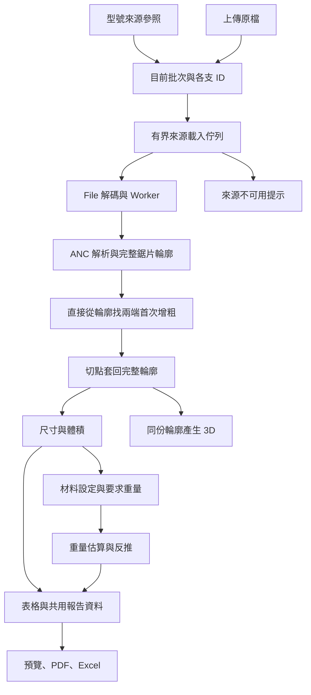

# 架構總覽

## 系統邊界

網站由 [main.tsx](../../src/main.tsx) 載入主題與 React，交由 [App.tsx](../../src/App.tsx) 管理上傳、型號庫、材料設定及手機／電腦分流。本機 Node 服務只提供靜態檔案；GitHub Pages 同樣提供建置產物。分析與瀏覽器保存不依賴遠端 API。

## 責任分工

| 位置 | 責任與主要入口 |
| --- | --- |
| [domain](../../src/domain) | ANC、掃掠幾何、切線／握把策略、體積、重量、單位、分類；不依賴 React 或瀏覽器保存 |
| [config](../../src/config) | 校準、規則參數、佇列、保存格式、主題與報告樣式；部分既有局部常數仍在使用處 |
| [services](../../src/services) | 檔案讀取／解碼、型號庫、Worker pool、增量佇列及保存介面 |
| [workers](../../src/workers) | 接收具工作 ID 的分析請求，呼叫 `analyzeAnc` 並回傳可序列化結果 |
| [hooks](../../src/hooks) | React 與批次、分析、刀寬、直徑扣除量及螢幕斷點的銜接 |
| [features/batch](../../src/features/batch) | 表格資料模型、排序／欄寬、選取編輯、設定與報告預覽流程 |
| [components](../../src/components) | 手機卡片、桌面單支、型號庫、共用按鈕及 3D 呈現 |
| [lib](../../src/lib) | 顯示格式、檔名、文字量測及單位呈現；不回寫幾何精度 |
| [reports](../../src/reports) | 以共用 `BatchView` 排版與輸出，不重新分析 ANC |
| [i18n](../../src/i18n/zh-TW.ts) | 網頁介面文字、診斷與格式用語 |

## 分析與資料生命週期

[useBatchSession](../../src/hooks/use-batch-session.ts) 持有目前批次識別、要求重量與顯示設定；[session-sources.ts](../../src/services/session-sources.ts) 將來源參照或上傳原檔轉成載入工作，交給 [useAnalysis](../../src/hooks/use-analysis.ts)。`IncrementalAnalysis` 對來源載入及分析共用併發限制，取得 File 後經 `analyzeFile` 解碼，再交由 `AnalysisWorkerPool` 執行。預設兩個 Worker，頁面載入預熱、完成後重用；取消或故障的 Worker 會終止，下一次工作再建，卸載時釋放。

新增只分析新項目；移除取消指定工作，清空取消全部。工作物件身分與 ID 用於排除晚到載入與結果，舊工作不能把已移除資料插回。更改鋸片寬度依來源重新取得 File 後分析整批；材料、單位、要求重量與顯示欄位變更不重新解析 ANC。來源更新、移除及舊格式相容的權威契約見 [資料保存與設定](資料保存與設定.md)。

[analysis-state.ts](../../src/services/analysis-state.ts) 的項目保留來源 metadata，並區分 loading、領域 result 與來源 unavailable。來源載入失敗或不存在時不進入幾何核心；型號路徑與來源標示不擴充成 ANC 解析規則或領域診斷。

`analyzeAnc` 回傳 `calculated` 或 `undetermined`。完整幾何位於 `profile.points`，裁切後位於 `retained`，診斷與可用的部分結果依狀態保留。3D 的整枝模式使用前者、切除後模式使用後者；尺寸、體積使用裁切結果。詳見 [ANC 與鋸片計算](ANC與鋸片計算.md)。

## 呈現與擴充

電腦與手機共用領域公式及 App 層設定；桌面與報告由 [buildBatchView](../../src/features/batch/view-model.ts) 組合資料，手機卡片則呼叫相同重量核心與顯示 helper。這是共同計算來源，不代表每個介面都必須共用同一個大型元件。

端面量測距離隨領域尺寸結果提供，畫面與報告由 [measurement-display.ts](../../src/lib/measurement-display.ts) 格式化，不從顯示網格重新找極值。定義與精度見 [切線、尺寸與重量](切線尺寸與重量.md#端面量測距離)，顯示選擇與輸出適配見 [操作文件](手機與電腦操作.md#電腦表格)及[報告與列印](報告與列印.md)。

新增切線或握把規則時，沿用各自的 strategy 介面與 registry；相互矛盾時回報無法判斷。新增報告或欄位優先擴充共用資料與欄位定義，renderer 不自算幾何。主 UI 使用增量佇列；`services/analyze-batch.ts` 是另有測試的批次工具，不是目前 App 的分析入口。

邊界與待辦見 [待辦與已知限制](待辦與已知限制.md)；保存與競態細節見 [資料保存與設定](資料保存與設定.md)。
